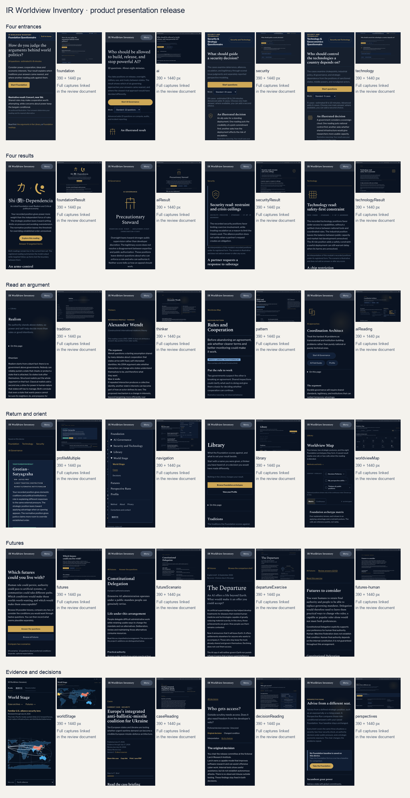

# Navigation and reader copy: before / after

Base: PR59 merge `445c5d6107c6c90402155654dad8e97bc82c54dc`. Its final head matches the accepted `b10da2ed8149aa8f1ffb907651b22f2405c3357e`. Scope: navigation, parent links, the AI Field Guide and a narrow Profile-label wrapping fix exposed by the 320px acceptance check.

## Field Guide

### Opening

**Before:** Six approaches to governing powerful AI answer the same question differently: who may inspect a model, release it, restrict it, or stop it. This guide works one decision through all six and sets out where each would put those powers. It ends with what the questionnaire leaves out.

**After:** A lab has built a powerful model. Releasing its weights would let others study and use it independently; keeping the weights inside the lab would limit that access. Who should decide, and what would justify their choice?

“Powerful” is retained from the supplied passage, as authorized by this brief. AI Governance now names the parent link; the questionnaire action remains separate.

### Shared scenario

**Before:** The fictional Larch Research Institute must decide how to provide access to a capable model for the next three months. Its internal tests show useful software and cyber assistance but do not establish autonomous attacks, and no misuse has been observed outside testing. The options are downloadable weights, qualified external evaluation in a secure enclave, or a hosted service with deeper evaluation kept inside Larch. In the enclave, an independent panel admits qualified teams and Larch cannot veto a qualified applicant; a revised arrangement gives Larch the final veto. Staffing, screening criteria, wait times and publication rights stay the same under both.

**After, displayed as setup, options, admission comparison and unchanged conditions:**

The fictional Larch Research Institute must decide how to provide access to a capable model for the next three months. Its internal tests show useful software and cyber assistance but do not establish autonomous attacks, and no misuse has been observed outside testing.

- Publish downloadable weights that anyone can run or modify. Released copies cannot be recalled.
- Admit qualified external evaluators to a secure enclave, with general access through a monitored hosted service.
- Offer a monitored, rate-limited hosted service, keeping weights and deeper evaluation inside Larch.

**Original admission:** An independent panel admits qualified teams and makes final admission decisions. Larch cannot veto a qualified applicant.

**Revised admission:** The revised arrangement gives Larch final admission power and a veto over applicants who meet the same criteria.

**Unchanged conditions:** Staffing, budget, screening criteria, wait times, research permissions and publication rights stay the same. Capability and misuse evidence, and the public-weights and hosted-service options, also stay fixed.

**Research permissions:** Qualified enclave participants may inspect and modify the model, export approved findings and publish criticism under the existing export terms. Weights remain inside the enclave.

**Uncertainty:** Larch does not know how much new benefit or misuse wider access would produce. No arrangement guarantees safety or useful criticism.

This restores visible details from `getPublishedDecision("who-gets-access")`: general hosted access alongside the enclave, budget, research permissions and export terms. The published exercise is unchanged. No staff shortage, safety guarantee, catch-up deadline or appeal mechanism is added.

### Precautionary Steward

**Before:** The model's cyber assistance raises the question of what wider release would enable. An enclave lets outside teams investigate while the downloadable weights stay inside Larch. The argument then asks what further evidence would justify giving up the ability to recall copies. Irreversibility alone does not answer every release question.

**After:** Publishing the weights would let anyone run or modify the model, and Larch could not retrieve the released copies. An enclave gives qualified outsiders access without distributing those weights. A precautionary argument favors keeping that control while further testing examines the cyber risks and what would justify wider release.

### Strategic Competitor

**Before:** Hosted access and enclave evaluation both keep the model's copies under Larch's control. Wider release could also help other actors develop the capability. So this argument weighs the value of outside scrutiny against access by teams whose strategic interests conflict with Larch's. The three-month period is a horizon for the decision, not evidence of when a rival will catch up.

**After:** Publishing weights would let competitors build on Larch's work. Hosted access or an enclave would keep the weights inside, while offering different opportunities for outsiders to investigate. A strategic argument asks which researchers should gain access, what they could learn, and how that knowledge might benefit a rival.

### Coordination Architect

**Before:** Under the original arrangement an independent panel applies an admission rule that Larch cannot override. A coordination argument asks whether other institutes could adopt comparable criteria and recognize the evaluations that result. The developer veto moves final discretion to Larch. The arrangement still has rules; what changes is who decides the hard cases and whether an excluded applicant can contest the decision.

**After:** Other institutes could use comparable admission criteria and recognize one another's evaluations. The independent panel gives Larch less discretion to exclude qualified applicants. A coordination argument asks whether that arrangement could support cooperation between institutes, and how a developer veto would affect their willingness to rely on it.

### Democratic Guardrailist

**Before:** Evaluators keep the right to publish criticism under both enclave arrangements. Accountability also depends on who gains access and who can contest an exclusion. This argument asks who appoints and oversees the admission authority. Independence from Larch does not by itself make the panel publicly accountable.

**After:** Evaluators may publish criticism under both arrangements. The difference is who gets inside: an independent panel admits qualified teams in the first; Larch can veto them in the second. Public accountability raises another question: who appoints that decision-maker, oversees its choices and hears a complaint from an excluded researcher?

### State Capacity Builder

**Before:** Screening applicants and supporting their investigations takes staff and money, and in this exercise both stay fixed. The argument asks whether the responsible bodies can perform the work they authorize, and who covers a shortfall if they cannot. It wants that answer before it treats hosted access as the only workable arrangement.

**After:** The enclave requires people to screen applicants and support their work. A state-capacity argument asks whether the responsible bodies have the staff, money and authority to do that job. Before choosing, it would need to know how much work each arrangement requires and who can deliver it.

### Open Ecosystem Builder

**Before:** Downloadable weights let researchers outside the qualified group reproduce and modify the model. The enclave limits who takes part even when an independent panel decides admission. This argument weighs broader investigation against copies Larch cannot revoke. Support for independent scrutiny does not by itself settle whether unrestricted release is justified.

**After:** Publishing the weights lets researchers outside the qualified group reproduce and modify the model. An independent admission panel still leaves some researchers out. Wider access would reduce that dependence on permission, but Larch would lose the ability to recall the copies. Is access for more researchers worth giving up that control?

These remain illustrative arguments, with several approaches able to support the same option. The accountability question asks what would be needed; it does not supply an appeal process. Fixed resources are stated in the scenario, not repeated as a caveat in the State Capacity Builder reading. Repetitive short questions were removed for the Steward, Architect and Capacity Builder; the other three remain.

### Framing and the three exact edits

- **Illustrations:** The repeated closing paragraph (“These readings are authored illustrations. Nothing on this page is scored, and none of them is attached to you…”) becomes one introduction: “These illustrative arguments show how the six approaches could read this decision. Several may support the same arrangement for different reasons. To make your own decision, open the exercise.”
- **Open Ecosystem Builder / Coordination Architect:** “Wider reproducibility comes with copies that nobody can restrict afterward, and shared rules can harden into a club of the already powerful.” → “Wider access allows more researchers to reproduce the work, while Larch loses the ability to recall released copies. Shared rules raise a different concern: whether the participating firms and states would exclude others.” Recall of copies is distinct from later legal restrictions.
- **Worker voice:** “Would your result change if worker voice, and neither frontier safety nor state capacity, were the starting point?” → “How would you judge workplace AI if workers' bargaining power were your main concern?” This is a reading prompt, with no inferred score change.
- **Axes:** “Your answers give positions on these axes. Each runs between two poles, and either end is a position. Each approach weights those positions differently, and the comparison decides which result leads. It says nothing about technical expertise, or about whether the institutions you favor can be built in time.” → “Your answers give positions on the axes below. Each approach weights those positions differently; the comparison determines which result leads.” Pole definitions stay visible; Method is linked beside the explanation.

## Navigation labels and links

| Destination | Before | After |
| --- | --- | --- |
| `/quiz` on root | Inventory | Foundation |
| `/explore` | Atlas / Explore / field guide | Library |
| `/modules` | Focus Areas | Security and Technology |
| `/profile` | My Profile / profile | Profile |
| `/explore/atlas` in Profile | Open Atlas | Open Worldview Map |
| `/explore/reference` | Thinkers & public positions / reference profiles / reference directory | Thinkers |
| `/ai/atlas` | AI Atlas / The six approaches / AI governance archetypes | AI approaches |
| AI questionnaire chrome | AI Questionnaire / AI Governance Compass / Exit to AI home | AI Governance |
| Perspective chrome and return links | Perspective Brief / Exit to briefs / All briefs / Try another brief | Perspective Run / Perspective Runs |
| Foundation archetype return | Back to your result or Take the Foundation | Foundation archetypes, plus Your Foundation result when the existing allowlist accepts it |
| Case source/correction return | Return to the case | The case’s title |
| `/method` in shared chrome | Methods | Method |

**Root explanation:** “Begin with the Foundation: fourteen questions about the arguments people reach for when world politics gets hard. Then, if you want, take Security, Technology, or AI Governance…” → “Foundation asks fourteen questions about the arguments people reach for when world politics gets hard. You can also start with Security, Technology, or AI Governance…” The final clause is unchanged. Security, Technology and AI Governance each have an ordinary secondary link. The five destination IDs, paths and globe interaction are unchanged. The approved Chinese explanation retains its recommendation to start with Foundation under the Chinese prose freeze; the secondary links allow independent entry without a prerequisite.

**Mobile introduction:** “Take the Foundation, then Security, Technology, or AI Governance. Cases and Perspective Runs put your judgment to work.” → “Choose Foundation, Security, Technology, or AI Governance. Cases and Perspective Runs put your judgment to work.”

World Stage, Decisions and the Library’s deeper indexes are included in compact navigation. Detail templates now supply or reuse destination links, including shared/invalid results and missing thinker records. Existing Futures links remain in place. The new All decisions link performs document navigation through the existing clear-on-exit lifecycle. Questionnaire step Back, saved drafts and result-return allowlists retain their existing behavior.

**Chinese interface wording for owner inspection:** Root 问卷 → 基础问卷; 图谱 → 观点资料. Shared navigation 议题专题 → 安全与技术; 我的画像 → 档案; 思想家与公共立场 → 思想家. Added destinations use 世界舞台, 决策练习, AI 治理取向, 基础原型, 安全, 技术 and 关于. 基础问卷, 观点资料, 档案 and 世界舞台 reuse existing interface equivalents. The Worldview Map’s secondary links use 思想家 and 档案. Approved Chinese explanatory copy and questionnaire text remain unchanged; unsupported routes keep the existing translation-status notice.

**Footer:** Personal contact/social links leave the global footer. About is added beside Method, Privacy and Corrections and contact, with prefetch disabled to preserve the exercises’ existing request boundary. Authorship, the project email on About/contact, licence files and attribution remain.

## Style-guide corrections

- The “sided with the institutionalist reading” exemplar becomes: “The strongest contribution to Institutionalism's lead came from your answers about institutions.” It requires the actual largest positive contribution to the lead over the compared rival; a label alone cannot establish a belief.
- Standard navigation and repeated control labels are desirable. The rule targets repeated empty explanations.
- Necessary figure explanations may stay beside the figure. Notes correcting prior drafts belong here.

## Review evidence

### Original-size screenshots

All images are unscaled viewport captures at device-pixel ratio 1, 900px high. The after images use the production build. The [before introduction](../../artifacts/navigation-reader-copy/before/field-guide-intro-1440.png) uses the verified base in development mode.

| View | Inspected after screenshots |
| --- | --- |
| Field Guide introduction | [390px](../../artifacts/navigation-reader-copy/after/field-guide-intro-390.png) · [1440px](../../artifacts/navigation-reader-copy/after/field-guide-intro-1440.png) |
| Worked admission comparison | [1440px](../../artifacts/navigation-reader-copy/after/field-guide-scenario-1440.png) |
| Six illustrative readings | [1440px](../../artifacts/navigation-reader-copy/after/field-guide-readings-1440.png) |
| Powers table | [320px](../../artifacts/navigation-reader-copy/after/field-guide-powers-320.png) · [768px](../../artifacts/navigation-reader-copy/after/field-guide-powers-768.png) · [1440px](../../artifacts/navigation-reader-copy/after/field-guide-powers-1440.png) |
| Decision Pattern parent | [390px](../../artifacts/navigation-reader-copy/after/parent-route-390.png) · [1440px](../../artifacts/navigation-reader-copy/after/parent-route-1440.png) |
| Expanded mobile menu | [390px](../../artifacts/navigation-reader-copy/after/menu-390.png) |
| Shared Profile label wrapping | [320px](../../artifacts/navigation-reader-copy/after/shared-profile-320.png) |

**Visual inspection:** Each linked image above was opened and inspected, plus the introduction at 320/768px and the 1440px no-JS and print-media captures. The original/revised admission headings remain visible; prose is narrower than the desktop table; the six readings use unfilled paired columns; mobile powers rows stack their two labeled cells without horizontal overflow. The menu scrolls within the viewport. The print capture is a browser print-media view, not a paginated PDF review. Other retained captures are supporting records, not claimed visual inspections. The scoped layout scan returned no findings.

### Checks

**Run here, passed:** `npm run validate`, `npm run lint`, `npm run test` (722/722), `npm run typecheck`, `npm run copy:audit:strict`, `npm run evidence:audit:check`, and the production build with an empty Mapbox token. The strict gate passed; recorded copy findings remain 17 P0 / 132 P1 / 1,101 P2, unchanged from the base—not zero advisory findings.

The complete CI browser sequence ran against production servers, with `CI=1`:

| Stage | Local result |
| --- | --- |
| `npm run test:e2e` | 181 passed, Chromium |
| Decision-exercise configuration | 29 passed, Chromium |
| Result-interpretation configuration | 25 passed, 1 existing skip, Chromium + WebKit |

**Exclusions:** The 162-route crawl runs once in Chromium; its duplicate WebKit run remains skipped, while representative interactions run in both engines. The main suite remains Chromium-only. Existing development-server exclusions for cache headers, Departure privacy and three print tests did **not** apply because these runs used production servers. PR59’s prior accepted CI record and the workflow configuration were read; that historical run was not rerun here. Current-head remote CI is reported on the draft PR.

**Keyboard and reflow:** Native Tab reached every menu link, scrolled focused links into view, and kept focus rings inside the panel. Escape returned focus to the trigger; Tab could leave the non-modal menu. Fresh pages checked 39 parent/recovery/shared routes at each of 320/390/768/1440px, with no horizontal overflow. Separate checks covered locale dispatch, preserved module drafts, clearing ephemeral decision answers on exit, semantic table header associations, anchors, print and no-JS content.

Earlier browser runs caught obsolete label assertions and the new About link’s unintended prefetch; exact expectations and the prefetch behavior were corrected without relaxing privacy or content checks. Clean reruns also resolved local evidence-refresh/generated-report races. Historical evidence and screenshot baselines were not rewritten; generated exercise outputs went to scratch locations. Only the authorized current evidence summary and this change’s captures are retained.

The first remote CI run found a 2px shared-Profile overflow at 320px. Its existing `nowrap` labels also exceeded their card’s text area locally. Profile labels now wrap within that area; wording, typography and scoring are unchanged. The acceptance test additionally checks each label against its container, retaining the viewport assertion. The 320px correction screenshot above was visually inspected.

Text checks prevent known regressions; they do not prove semantic equivalence. The no-positive contribution fixture modifies signs to exercise a helper state; it does not demonstrate that a complete questionnaire produces that state.

## Product-wide presentation release — 16 September 2026

Release base: PR60's actual merge, `4f4f22ba1b51760f2f0cd9f77ff47042c713e6b0`. One isolated worktree and branch, `codex/product-wide-experience-finish`. The earlier PR60 passages above remain historical. This section describes the new release.

### Contact sheet and ordinary viewports

Each image is an ordinary viewport, not a stitched page or a substitute for the motion evidence. Desktop captures are 1440 × 1000; phones are 390 × 844. Changed shared layouts also have 320 × 844 and 768 × 1000 captures. Results and saved work use synthetic fixtures only. Images were captured from the production build with final UI source; the PR supplies the exact base/head and final-head checks.

| Family / runtime decision | 390px | 1440px |
|---|---|---|
| Foundation entrance — applied: question, live count, labelled estimate and illustration; compact active orientation; original review and copy binding retained | [View](../../artifacts/product-wide-experience/captures/foundation-390.png) | [View](../../artifacts/product-wide-experience/captures/foundation-1440.png) |
| AI entrance — applied: live Standard/Advanced count, one start/resume and compact mode control | [View](../../artifacts/product-wide-experience/captures/ai-390.png) | [View](../../artifacts/product-wide-experience/captures/ai-1440.png) |
| Security/Technology selector — applied: two editorial choices with domain marks; no prerequisite panel | [View](../../artifacts/product-wide-experience/captures/selector-390.png) | [View](../../artifacts/product-wide-experience/captures/selector-1440.png) |
| Security entrance — applied: decision, mode, live case count, estimate, illustrated reasoning and reading/exercise exits | [View](../../artifacts/product-wide-experience/captures/security-390.png) | [View](../../artifacts/product-wide-experience/captures/security-1440.png) |
| Technology entrance — applied: control/dependence question and the same task controls, with its own illustration | [View](../../artifacts/product-wide-experience/captures/technology-390.png) | [View](../../artifacts/product-wide-experience/captures/technology-1440.png) |
| Foundation result — applied: canonical pure/blend drawing on actual completion; retained interpretation, comparisons and answer provenance | [View](../../artifacts/product-wide-experience/captures/foundationResult-390.png) | [View](../../artifacts/product-wide-experience/captures/foundationResult-1440.png) |
| AI result — applied: six distinct marks and drawing; retained tied readings and exact fresh answer evidence | [View](../../artifacts/product-wide-experience/captures/aiResult-390.png) | [View](../../artifacts/product-wide-experience/captures/aiResult-1440.png) |
| Security result — applied: shield/chevrons, left-led headline and adjacent evidence; existing result dispatch retained | [View](../../artifacts/product-wide-experience/captures/securityResult-390.png) | [View](../../artifacts/product-wide-experience/captures/securityResult-1440.png) |
| Technology result — applied: lattice mark, horizontal composition and adjacent evidence; existing result dispatch retained | [View](../../artifacts/product-wide-experience/captures/technologyResult-390.png) | [View](../../artifacts/product-wide-experience/captures/technologyResult-1440.png) |
| Profile, multiple results — applied: direct saved-result index, actual domain rows and quiet relation limit; history/share/delete/export retained | [View](../../artifacts/product-wide-experience/captures/profileMultiple-390.png) | [View](../../artifacts/product-wide-experience/captures/profileMultiple-1440.png) |
| Profile, empty — applied: four independent starting points, no invented result | [View](../../artifacts/product-wide-experience/captures/profileEmpty-390.png) | [View](../../artifacts/product-wide-experience/captures/profileEmpty-1440.png) |
| Shared navigation — applied: native section disclosures, utility group and language control; non-modal native traversal, dismissal and focus return | [View](../../artifacts/product-wide-experience/captures/navigation-390.png) | [View](../../artifacts/product-wide-experience/captures/navigation-1440.png) |
| Library — applied: four reading families first; model explanations in an accessible disclosure with all anchors | [View](../../artifacts/product-wide-experience/captures/library-390.png) | [View](../../artifacts/product-wide-experience/captures/library-1440.png) |
| Traditions — applied: argument, applications and objection; lighter mobile contents, supporting archetypes below the argument | [View](../../artifacts/product-wide-experience/captures/tradition-390.png) | [View](../../artifacts/product-wide-experience/captures/tradition-1440.png) |
| Thinkers — applied: dated source-bound argument first, contrasting evidence beside it; added labelled illustrations for Wendt and Strange | [View](../../artifacts/product-wide-experience/captures/thinker-390.png) | [View](../../artifacts/product-wide-experience/captures/thinker-1440.png) |
| Decision Patterns — applied: argument, one application and objection; removed three repeated lead formulations and lowered technical descriptor | [View](../../artifacts/product-wide-experience/captures/pattern-390.png) | [View](../../artifacts/product-wide-experience/captures/pattern-1440.png) |
| Worldview Map — retained: matrix and continuous projection, layers and focused mobile map; public pattern template improved | [View](../../artifacts/product-wide-experience/captures/worldviewMap-390.png) | [View](../../artifacts/product-wide-experience/captures/worldviewMap-1440.png) |
| Foundation archetype index — retained: eight canonical marks, contrasting posture rows and explanatory key | [View](../../artifacts/product-wide-experience/captures/archetypes-390.png) | [View](../../artifacts/product-wide-experience/captures/archetypes-1440.png) |
| Thinker index — applied: editorial argument rows with evidence qualifications and source links | [View](../../artifacts/product-wide-experience/captures/thinkers-390.png) | [View](../../artifacts/product-wide-experience/captures/thinkers-1440.png) |
| AI approach index — applied: six full-width fingerprint/argument rows and two-column comparisons | [View](../../artifacts/product-wide-experience/captures/aiApproaches-390.png) | [View](../../artifacts/product-wide-experience/captures/aiApproaches-1440.png) |
| AI approach detail — applied: compact subject identity; argument → practical implications → objection → sources | [View](../../artifacts/product-wide-experience/captures/aiReading-390.png) | [View](../../artifacts/product-wide-experience/captures/aiReading-1440.png) |
| Field Guide — applied: one resolved start/saved return and compact mobile contents; retained exact scenario powers, uncertainty and all six readings | [View](../../artifacts/product-wide-experience/captures/fieldGuide-390.png) | [View](../../artifacts/product-wide-experience/captures/fieldGuide-1440.png) |
| Futures catalogue — applied: compact contents for all 19 entries, clear 12-question/expectation orientation | [View](../../artifacts/product-wide-experience/captures/futures-390.png) | [View](../../artifacts/product-wide-experience/captures/futures-1440.png) |
| Ordinary future — applied: life/institutions beside practical authority and unresolved conditions | [View](../../artifacts/product-wide-experience/captures/futureScenario-390.png) | [View](../../artifacts/product-wide-experience/captures/futureScenario-1440.png) |
| Departure scenario — applied: same peer reading treatment; premise/descriptors unchanged | [View](../../artifacts/product-wide-experience/captures/departureScenario-390.png) | [View](../../artifacts/product-wide-experience/captures/departureScenario-1440.png) |
| Departure exercise — retained: fictional conditions and neutral diagrams, three comparisons, review, independent powers and separate-tab consultation | [View](../../artifacts/product-wide-experience/captures/departureExercise-390.png) | [View](../../artifacts/product-wide-experience/captures/departureExercise-1440.png) |
| World Stage — retained: reviewed dated scenes, sources and honest no-token still fallback; root globe is a separate lightweight presentation | [View](../../artifacts/product-wide-experience/captures/worldStage-390.png) | [View](../../artifacts/product-wide-experience/captures/worldStage-1440.png) |
| Cases — applied: dated evidence records before adjacent projects; archive/current status retained | [View](../../artifacts/product-wide-experience/captures/cases-390.png) | [View](../../artifacts/product-wide-experience/captures/cases-1440.png) |
| Case reading — retained: date, actor context, evidence and challenge → judgment sequence | [View](../../artifacts/product-wide-experience/captures/caseReading-390.png) | [View](../../artifacts/product-wide-experience/captures/caseReading-1440.png) |
| Decisions index — retained: distinct authored questions and separate exercise entry, no questionnaire prerequisite | [View](../../artifacts/product-wide-experience/captures/decisions-390.png) | [View](../../artifacts/product-wide-experience/captures/decisions-1440.png) |
| Decision exercise — retained: given/revised conditions, neutral inspection and permission diagrams, deliberate review and ephemeral exit | [View](../../artifacts/product-wide-experience/captures/decisionReading-390.png) | [View](../../artifacts/product-wide-experience/captures/decisionReading-1440.png) |
| Perspective Runs — applied: actor/mandate/agenda rows and role-conditioned orientation; baseline comparison, role answers and result dispatch retained | [View](../../artifacts/product-wide-experience/captures/perspectives-390.png) | [View](../../artifacts/product-wide-experience/captures/perspectives-1440.png) |
| Method — retained: chapter structure, measured limits, source and calculation links | [View](../../artifacts/product-wide-experience/captures/method-390.png) | [View](../../artifacts/product-wide-experience/captures/method-1440.png) |
| References — retained: plain source bibliography and usable outgoing links | [View](../../artifacts/product-wide-experience/captures/references-390.png) | [View](../../artifacts/product-wide-experience/captures/references-1440.png) |
| About — applied: quiet reading measure and rule-separated sections; operator details retained | [View](../../artifacts/product-wide-experience/captures/about-390.png) | [View](../../artifacts/product-wide-experience/captures/about-1440.png) |
| Privacy — applied: quiet reading measure; all substantive data notices retained | [View](../../artifacts/product-wide-experience/captures/privacy-390.png) | [View](../../artifacts/product-wide-experience/captures/privacy-1440.png) |
| Feedback — applied: readable source/contact route; operator and contact information retained | [View](../../artifacts/product-wide-experience/captures/feedback-390.png) | [View](../../artifacts/product-wide-experience/captures/feedback-1440.png) |
| Root — applied: 140-second orthographic revolution, 14 question-led scenes, island points and manual/pause controls | [View](../../artifacts/product-wide-experience/captures/root-390.png) | [View](../../artifacts/product-wide-experience/captures/root-1440.png) |

Existing route/state contracts were used directly: the 162-route inherited crawl, full questionnaire journeys, actual result identity fixtures, history/copy cases, Decisions, Futures and result geometry suites. The legacy `/current` redirect, unknown result recovery, unavailable versions, unknown-copy comparison restrictions and Chinese translation-status routes retain their existing semantics. Chinese Foundation questioning and result prose remain on the original copy dispatch; the shared navigation and root scene captions are localized. No inventory-only substitute or new scored classification was added.

Changed shared layouts at [320px](../../artifacts/product-wide-experience/captures/navigation-320.png) and [768px](../../artifacts/product-wide-experience/captures/navigation-768.png): expanded panel geometry, all native links and focus rings are checked, with visible scrolling. Entrance, AI result/reading, Library, thinker, Futures and Profile captures at these widths sit in the same capture directory. The existing geometry suite also checks 719/720/721 breakpoints, 1024/1920 widths and 200% text enlargement.

### Finite identity galleries

All individual public records behind these changed templates were read. The galleries cover long labels and differing evidence coverage; the source qualifications remain in their pages. These are visual and content checks, not evidence of reader comprehension or methodological validation.

- [All 28 result marks](../../artifacts/product-wide-experience/mark-gallery.png): eight Foundation pure marks, twelve equal-weight blends, six AI approaches, two domain marks. Canonical Foundation geometry is unchanged.
- [All eight Foundation readings](../../artifacts/product-wide-experience/foundation-readings-gallery.png).
- [All ten Decision Patterns](../../artifacts/product-wide-experience/decision-patterns-gallery.png).
- [All four traditions](../../artifacts/product-wide-experience/traditions-gallery.png), including the partial coverage of Critical Political Economy.
- [All four thinkers](../../artifacts/product-wide-experience/thinkers-gallery.png), including Wendt's missing political-economy coverage and Strange's sparse profile.
- [All six AI readings](../../artifacts/product-wide-experience/ai-readings-gallery.png).

Every gallery's ordinary 390px identity capture is in [identities](../../artifacts/product-wide-experience/identities). The catalogue's nineteen entries and all six AI reading shelves remain available without a carousel.

### Futures states

The catalogue and ordinary/Departure scenarios were inspected alongside these real exercise states. All nineteen scenarios, twelve questions, non-negotiable confirmations, any-two comparison, optional Departure and separate expectations remain intact.

| State | 390px | 1440px |
|---|---|---|
| Preference review | [View](../../artifacts/product-wide-experience/captures/futuresReview-390.png) | [View](../../artifacts/product-wide-experience/captures/futuresReview-1440.png) |
| Human/plural preference result | [View](../../artifacts/product-wide-experience/captures/futures-human-390.png) | [View](../../artifacts/product-wide-experience/captures/futures-human-1440.png) |
| Tied / unresolved preferences | [View](../../artifacts/product-wide-experience/captures/futures-tied-390.png) | [View](../../artifacts/product-wide-experience/captures/futures-tied-1440.png) |
| Conflicting requirements | [View](../../artifacts/product-wide-experience/captures/futures-conflicted-390.png) | [View](../../artifacts/product-wide-experience/captures/futures-conflicted-1440.png) |
| Unconfirmed requirement | [View](../../artifacts/product-wide-experience/captures/futures-unconfirmed-390.png) | [View](../../artifacts/product-wide-experience/captures/futures-unconfirmed-1440.png) |
| Any-two comparison | [View](../../artifacts/product-wide-experience/captures/futuresComparison-390.png) | [View](../../artifacts/product-wide-experience/captures/futuresComparison-1440.png) |

### Continuous interaction evidence

- [Foundation: actual review submit → mark drawing → completed interpretation](../../artifacts/product-wide-experience/recordings/foundation-submit-to-result.webm).
- [AI Governance: actual review submit → mark drawing → completed interpretation](../../artifacts/product-wide-experience/recordings/ai-submit-to-result.webm).
- [Security: actual review submit → mark drawing → completed interpretation](../../artifacts/product-wide-experience/recordings/security-submit-to-result.webm).
- [Technology: actual review submit → mark drawing → completed interpretation](../../artifacts/product-wide-experience/recordings/technology-submit-to-result.webm).
- [Root: complete normal-speed scene cycle](../../artifacts/product-wide-experience/recordings/root-complete-scene-cycle.webm), continuously showing all fourteen scenes. No clock acceleration or menu-driven fill changes.

Recordings use the real review submit handlers with declared synthetic answers. No answer-bearing motion parameters, storage keys or tracking were added. The completed server render is enhanced by a matching in-memory completion handoff; Replay is optional. Reduced motion, no-JavaScript, reload, direct/shared entry, browser Back, interruption and print are covered by the browser suites. Foundation filled shapes use authored brush masks; stroked paths use measured path lengths and ordered draws. Motion is decoration on an immediately readable name and interpretation.

### Whole changed prose passages

#### Foundation entrance

**How do you judge the arguments behind world politics?**

14 questions · estimated 6–8 minutes

Consider power, cooperation, ideas and economic interests. Your result explains which traditions your answers came nearest, and where another reading pulls against them.

**Illustrative result: Concert, near Shi.** Shared rules may make cooperation worth attempting, while concerns about power keep the bargain conditional.

An authored illustration. Your answers determine your reading and its nearest alternative.

Read first: the arguments in the Library, or Foundation readings.

The count comes from the active form. Extension, repair and resumed states retain their own orientation rather than repeating this fresh entrance. “Start Foundation” dismisses this introduction and focuses the current question; selection never advances it.

#### AI entrance and direct quiz entry

The retained main opening asks: **Who should be allowed to build, release, and stop powerful AI?**

The live metadata reads **22 questions. About eight minutes.** in Standard, and **37 questions. More detailed scenarios.** in Advanced. The retained explanation is:

You take positions on release, oversight, military use, and rivalry between states. The result shows which of six governing approaches your answers came nearest, and where the closest rival approach would have decided differently.

Advanced adds 15 questions on compute, audits, and incident reporting.

The existing synthetic-fixture-supported illustration is now headed **An illustrated result**:

Illustrative result explanation. **Precautionary Steward**, with Democratic Guardrailist as the nearest rival. “The burden of proof rises with capability: you wanted thresholds and outside testing before broad deployment. The nearest alternative, Democratic Guardrailist, binds the same check to public oversight instead of to the capability itself.” Your own result names the approach, the rival, and the question your answers left open.

Direct quiz entry without a selected mode uses:

**Who should govern powerful AI?** Take positions on release, oversight and rivalry, then compare your closest governing approach with its nearest rival.

Standard takes about eight minutes. Advanced adds questions on audits, compute and incident reporting.

The action resolves to **Start AI Governance**, **Resume AI Governance**, or a genuine saved-result return, according to that consumer's state. Active answering has the shorter heading **AI Governance**. None of the administered questions changed.

#### Security and Technology

The selector is titled **Security and Technology**. Its retained lead is:

An ally asks for troops on its border. A ministry decides whether to fund public compute. You choose, and the result shows which logic you kept returning to. Each questionnaire gives its own result and leaves your Foundation result alone.

The Security entrance asks **What should guide a security decision?** Its illustration reads:

An ally asks for a standing deployment. One reading puts the credibility of a joint commitment first; another asks how the deployment affects the risk of escalation.

The Technology entrance asks **Who should control the technologies a country depends on?** Its illustration reads:

A government considers a sovereign cloud. One reading puts national control first; another asks whether shared infrastructure would give researchers more usable capacity.

Each is followed by **Illustrative reasoning. Your result uses your choices across the cases.** The live count/estimate line reads: **{current case count} cases · estimated {existing mode estimate}. Advanced adds {additional cases} cases. Choose one main answer; where available, you can add a second choice.** Security's current Standard form is 19 cases, Advanced 23; Technology is 9/15. The unchanged definition supplies each mode's estimate.

Secondary routes read **Read Decision Patterns, or try Who gets to verify?** for Security and **Read Decision Patterns, or try Who gets access?** for Technology. A real linked Foundation alone adds: **Linked Foundation: {resolved family}. This questionnaire gives its own result.**

#### Rules and Cooperation

**Opening:** Before abandoning an agreement, ask whether clearer terms and better monitoring could make it work.

**Put the rule to work:** Two governments suspect the other is breaking an agreement. Shared inspections could clarify what each is doing and give them a basis for deciding whether cooperation can continue.

**The objection:** Monitoring may reveal a violation without giving anyone enough leverage to stop it.

The application is labelled **Illustrative reasoning, not observed behavior.** Every other Decision Pattern keeps its existing argument, security application and objection; the template no longer repeats them as “Decision rule”, “Notices first” and “Likely move”. Its technical descriptor is now in Method and editorial status. The later Security continuation reads **Try Security to decide cases such as the one above.**

#### Thinker applications

**Alexander Wendt:** Two governments exchange the same security guarantee. Ask whether they understand one another as partners or adversaries, then consider how that relationship changes the promise's meaning. A signature alone cannot establish a shared identity.

**Susan Strange:** A government receives a cheap offer for digital infrastructure. Ask who can change the financing terms, restrict access to knowledge or deny future upgrades. The initial price cannot settle whether the government will retain useful alternatives.

Both are followed by: **An authored illustration of the argument above, not an attributed policy recommendation.** These applications draw on the dated source-supported arguments already present, without adding a current policy attribution. The full existing summary and scope note remain under **Scope of this public position**.

#### AI reading index and objections

Compare six approaches to governing capable AI, their institutional priorities, objections and sources.

Each approach has a longer argument, a policy application and a serious objection. Read the source alongside the summary, or use the Field Guide to compare all six within one decision.

The link now says **Read the argument**. The full six objections below retain their substance; static readings use **Critics argue that** instead of addressing “Your critics”. Practical implications and their qualification are retained together and moved before the objection:

These proposals belong to this editorial category. A similar result does not establish that you support each one.

#### Profile

**Empty:** Your results, ready to return to.

Choose a question to begin. Foundation, AI Governance, Security and Technology can each be taken on their own. Results stay on this device unless you choose to share them.

- Start the Foundation — Answer fourteen broad questions.
- Try AI Governance — Create a separate AI-policy record.
- Start Security — Examine commitments, threats and force.
- Start Technology — Examine access, interdependence and industrial power.

No results are saved yet. No account is required. Try a short decision or browse the Library.

**Saved:** Saved on this device / Included in this share. The index links only actual results. Domain rows are headed **Saved domain results**:

Each result answers its own set of questions. Open it for the full reading and evidence.

Where no valid Foundation identity resolves, the heading is **Your saved work**. The unavailable record retains the explicit notice:

The saved Foundation payload cannot be resolved, so this Profile does not infer a replacement reading. Other saved records remain available below.

**How these records relate:** No reviewed cross-domain relation is available. Each result is shown on its own. The Profile does not infer a relationship from similar labels or numbers.

**What to open next** independently offers absent instruments:

- Add Foundation — Fourteen questions about international politics.
- Add Security — Examine commitments, threats and the use of force.
- Add Technology — Examine access, interdependence and industrial power.
- Add AI Governance — Examine who should govern capable AI.
- Open Perspective Runs — Consider another actor's constraints in a role-conditioned exercise.

#### Perspective Runs

Advise from a defined strategic position, such as an exposed ally or a rising power. A Perspective Run compares those role-conditioned answers with your saved Foundation. Your baseline stays unchanged.

The three-situation description, mandates and role constraints are retained.

#### Futures

19 scenarios · 12 questions about preferred conditions · Separate, optional expectations

English editorial draft. These scenarios overlap; they are not a set of exclusive destinies. The Departure is the catalogue’s one optional deeper exercise.

These relocate existing scope qualifications below the first invitation. The nineteen scenario descriptors, inherited/source attributions, ordinary/Departure narrative, preferences, expectations and comparison text are unchanged.

#### Shared reading and navigation labels

The shared directory uses the existing registry: Foundation; AI Governance (AI approaches, Field Guide); Security and Technology (Security, Technology); Library (Worldview Map, Thinkers, Foundation archetypes, References); World Stage (Cases, Decisions); Futures; Perspective Runs; Profile. Method, About, Privacy and Corrections and contact form the utility group. The old explanatory “Product path” and “Browse and context” text is removed.

The mobile contents disclosure reads **On this page** and keeps all anchors. Library's model explanation disclosure reads **Reading a Foundation result: dimensions, blends and coverage**. Foundation archetype reading pages now lead with their existing authored first-notice passage, listed below, then **Policy choices and tradeoffs**. Full qualification, historical limits and publication/research status remain later in the reading.

#### Eight static Foundation reading leads

**Kairos:** Kairos attends first to changing leverage and to windows that may close.

**Shi (勢):** Shi reads the field before the clash: incentives, dependencies, and positions reveal how leverage is forming.

**Grotian:** Grotian reasoning starts with the gap between stated commitments and rules that can carry force.

**Concert:** Concert first asks who can disrupt a settlement, what they fear, and what limits they will accept.

**Satyagraha:** Satyagraha looks first to the public meanings that sustain authority or strip it of acceptance.

**Musyawarah:** Musyawarah listens for objections that formal agreement can bury and for relationships the process must sustain.

**Dirigisme:** Dirigisme sees the bottleneck: scattered decisions have left a needed capacity unfunded or unbuilt.

**Dependencia:** Dependencia traces how external chokepoints and costly dependencies narrow practical autonomy.

#### Six complete AI reading objections

**Precautionary Steward:** Critics argue that precaution can become an incumbent-friendly politics of delay, especially if the institutions doing the slowing are not broadly trusted.

**Strategic Competitor:** Critics argue that a competition-first worldview can smuggle escalation into governance and gradually normalize risk in the name of realism.

**Coordination Architect:** Critics argue that coordination can become a beautiful theory with weak enforcement, or worse, a legitimating layer over unequal power.

**Democratic Guardrailist:** Critics argue that democratic legitimacy is essential but often too slow, too fragmented, or too technically thin to supervise frontier systems well in real time.

**State Capacity Builder:** Critics argue that capacity-building can slide into managerialism, missing deeper legitimacy problems or wider civilizational stakes.

**Open Ecosystem Builder:** Critics argue that openness can underweight tail risks and become complacent about the speed at which misuse and systemic danger can scale.

#### Root scene captions, dated keys and sources

The geographic scenes locate selected places; they do not encode allegiance. Relationship scenes reuse the reviewed dated World Stage source ledger. No new political grouping is asserted from a country’s location. Small-place points use pinned Natural Earth geometry, with provenance in the existing data-source note. The cycle covers Europe, Africa, Asia, Australasia, the Pacific, the Americas and the Caribbean. The sources are clickable in each scene.

**Where does this chip network depend on European equipment?**

Dated relationship · 2 Aug 2026 · ASML and ZEISS locations.

Two supplier locations in the reviewed World Stage network; not a complete industry map.

[ASML 2025 Annual Report / Veldhoven HQ pages / Dutch export-control updates](https://www.asml.com/investors/annual-report/2025); [ZEISS Semiconductor Manufacturing Technology products and sites](https://www.zeiss.com/semiconductor-manufacturing-technology/products.html).

**Where do Ethiopia, Kenya and Tanzania sit along eastern Africa?**

Geographic focus · Geometry: 14 Jul 2026; points: 16 Sep 2026 · Selected geographic focus.

[Natural Earth 1:110m · geometry and small-place points](https://www.naturalearthdata.com/downloads/110m-cultural-vectors/).

**Which partnership connects China and Pakistan in this record?**

Dated relationship · 14 Jul 2026 · Declared strategic partnership.

The joint statement calls this an all-weather strategic cooperative partnership.

[中华人民共和国和巴基斯坦伊斯兰共和国关于建立全天候战略合作伙伴关系的联合声明](https://www.mfa.gov.cn/gjhdq_676201/gj_676203/yz_676205/1206_676308/1207_676320/201504/t20150421_9288487.shtml).

**How do Indonesia, Malaysia and Singapore meet around these waters?**

Geographic focus · Geometry: 14 Jul 2026; points: 16 Sep 2026 · Selected geographic focus.

[Natural Earth 1:110m · geometry and small-place points](https://www.naturalearthdata.com/downloads/110m-cultural-vectors/).

**Which Indo-Pacific partners in this record have a U.S. defense treaty?**

Dated relationship · 14 Jul 2026 · Treaty partners in this record.

This is the reviewed Indo-Pacific selection, not a list of every U.S. treaty ally.

[MOFA: Japan-U.S. Security Treaty](https://www.mofa.go.jp/region/n-america/us/q%26a/ref/1.html); [Mutual Defense Treaty Between the United States and the Republic of Korea](https://avalon.law.yale.edu/20th_century/kor001.asp); [Mutual Defense Treaty](https://lawphil.net/international/treaties/mutdef.html); [United States of America country brief](https://www.dfat.gov.au/geo/united-states-of-america/united-states-of-america-country-brief).

**Where are Australia and New Zealand relative to the Pacific islands?**

Geographic focus · Geometry: 14 Jul 2026; points: 16 Sep 2026 · Selected geographic focus.

[Natural Earth 1:110m · geometry and small-place points](https://www.naturalearthdata.com/downloads/110m-cultural-vectors/).

**Which small Pacific states need a point at this scale?**

Geographic focus · Geometry: 14 Jul 2026; points: 16 Sep 2026 · Small-state locations.

[Natural Earth 1:110m · geometry and small-place points](https://www.naturalearthdata.com/downloads/110m-cultural-vectors/).

**Where are Samoa and Tonga across the date line?**

Geographic focus · Geometry: 14 Jul 2026; points: 16 Sep 2026 · Selected geographic focus.

[Natural Earth 1:110m · geometry and small-place points](https://www.naturalearthdata.com/downloads/110m-cultural-vectors/).

**How much ocean lies between New Zealand and Chile?**

Geographic focus · Geometry: 14 Jul 2026; points: 16 Sep 2026 · Two geographic reference points.

[Natural Earth 1:110m · geometry and small-place points](https://www.naturalearthdata.com/downloads/110m-cultural-vectors/).

**Where does this record locate U.S. cloud and AI institutions?**

Dated relationship · 14 Jul 2026 · U.S. institutions in this record.

Country-level location only; the fill does not measure cloud capacity.

[Microsoft 2025 Annual Report and Azure global infrastructure pages](https://www.microsoft.com/investor/reports/ar25/index.html); [AWS Global Infrastructure](https://aws.amazon.com/about-aws/global-infrastructure/); [Center for AI Standards and Innovation and NIST AI Consortium](https://www.nist.gov/caisi).

**Where do Barbados and Trinidad and Tobago sit in the Caribbean?**

Geographic focus · Geometry: 14 Jul 2026; points: 16 Sep 2026 · Small-state locations.

[Natural Earth 1:110m · geometry and small-place points](https://www.naturalearthdata.com/downloads/110m-cultural-vectors/).

**Which country held the 2025 BRICS presidency?**

Dated relationship · 1 Jan 2025 · 2025 presidency.

[Brazil assumes the presidency of BRICS in 2025 / Rio chosen to host BRICS Summit](https://www.gov.br/planalto/en/latest-news/2025/01/brazil-assumes-the-presidency-of-brics-in-2025).

**Where do Brazil and southern Africa face the South Atlantic?**

Geographic focus · Geometry: 14 Jul 2026; points: 16 Sep 2026 · Selected geographic focus.

[Natural Earth 1:110m · geometry and small-place points](https://www.naturalearthdata.com/downloads/110m-cultural-vectors/).

**Where are Senegal, Ghana and Nigeria along western Africa?**

Geographic focus · Geometry: 14 Jul 2026; points: 16 Sep 2026 · Selected geographic focus.

[Natural Earth 1:110m · geometry and small-place points](https://www.naturalearthdata.com/downloads/110m-cultural-vectors/).

**Shared source-control explanation:** Muted land is outside this question. Points locate small places; sizes do not encode influence. The 174-feature basemap omits some territories and islands.

**Boundary link:** Geometry and boundary cautions.

**Localized root captions and keys:**

- 这条芯片网络在哪些环节依赖欧洲设备？ — ASML与蔡司所在地。世界舞台已审阅网络中的两个设备供应商所在地，并非完整的产业地图。
- 埃塞俄比亚、肯尼亚和坦桑尼亚位于东非的什么位置？ — 选定的地理范围
- 这份记录中的哪种伙伴关系连接中国和巴基斯坦？ — 声明中的战略伙伴关系。联合声明将其称为全天候战略合作伙伴关系。
- 印度尼西亚、马来西亚和新加坡如何在这些海域相邻？ — 选定的地理范围
- 记录中的哪些印太伙伴与美国签有防务条约？ — 记录中的条约伙伴。这是已审阅的印太范围，并非美国所有条约盟友的名单。
- 澳大利亚和新西兰与太平洋岛屿的相对位置如何？ — 选定的地理范围
- 哪些太平洋小国在这个比例尺下需要用点表示？ — 小国位置
- 萨摩亚和汤加位于日期变更线附近的什么位置？ — 选定的地理范围
- 新西兰与智利之间隔着多大的海域？ — 两个地理参照点
- 这份记录将美国的云计算与人工智能机构定位在哪里？ — 记录中的美国机构。只标示国家层面的位置；填色不衡量云计算容量。
- 巴巴多斯和特立尼达和多巴哥位于加勒比海的什么位置？ — 小国位置
- 哪个国家担任了2025年金砖国家轮值主席国？ — 2025年轮值主席国
- 巴西与非洲南部如何隔南大西洋相望？ — 选定的地理范围
- 塞内加尔、加纳和尼日利亚位于西非的什么位置？ — 选定的地理范围

暗色陆地不在当前问题范围内。点表示小型地域的位置，大小不代表影响力。含174个地理要素的底图未包含某些领土和岛屿。

Controls: 来源 / 上一场景 / 下一场景 / 播放 / 暂停 / 地理数据与边界说明. Geographic/date labels: 地理范围 / 有日期的关系记录. Dates and proper source titles retain the source metadata.

### Review limits

These checks establish rendering, interaction, payload/history compatibility and existing data-boundary behavior. They do not establish comprehension, retention or scientific validation. Authored readings remain editorial; historical comparisons retain provisional status. World Stage was exercised without Mapbox credentials through its intentional still fallback. The root uses local geometry and dated reviewed sources, not a current remote feed; coarse geography does not show every territory. The design detector reported 27 warning-level styling advisories, largely from retained shared CSS; the navy/brass editorial identity and reviewed reading rules were retained rather than optimizing that count. No historical capture, instrument version, scoring formula, storage/API/analytics contract or canonical identity was changed.
